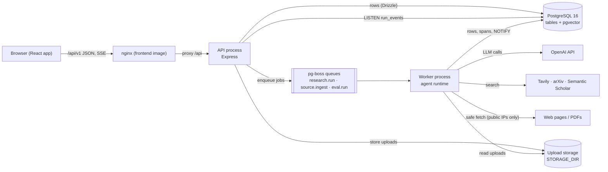
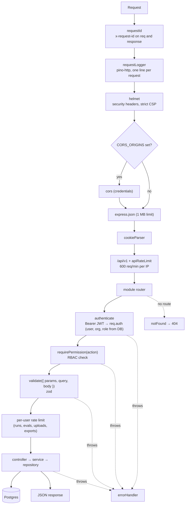
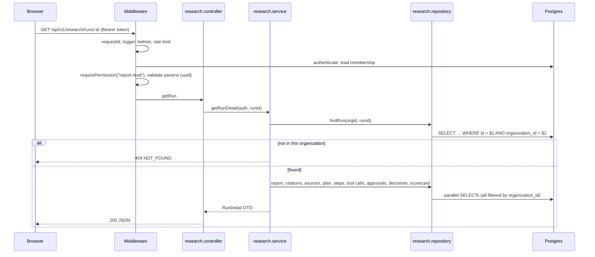
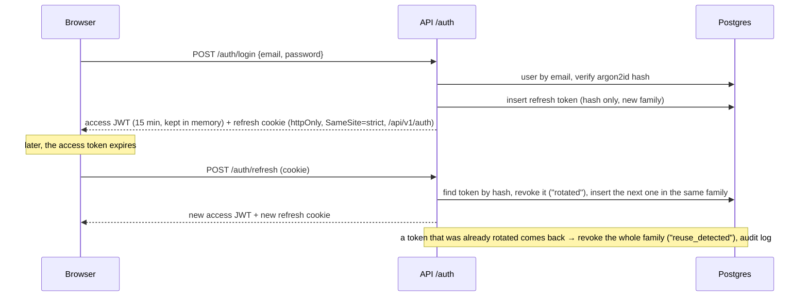
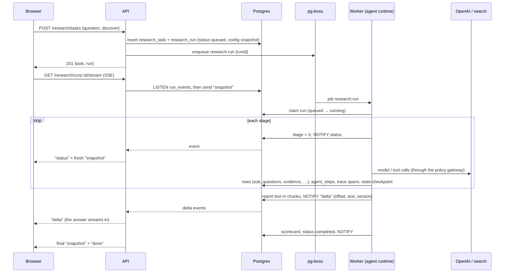
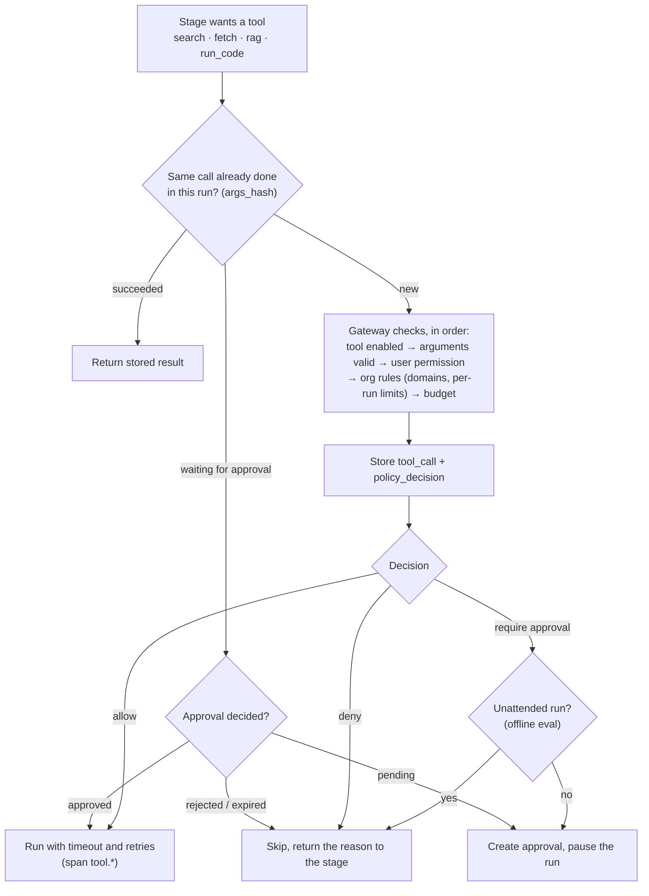
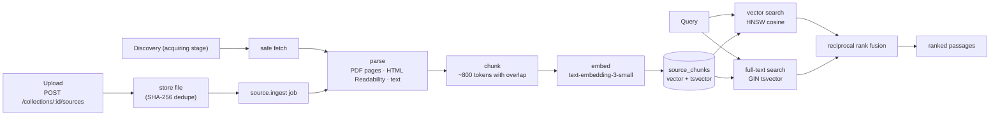
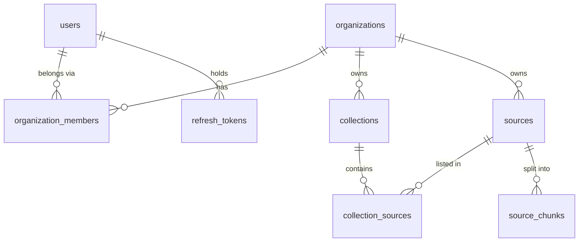
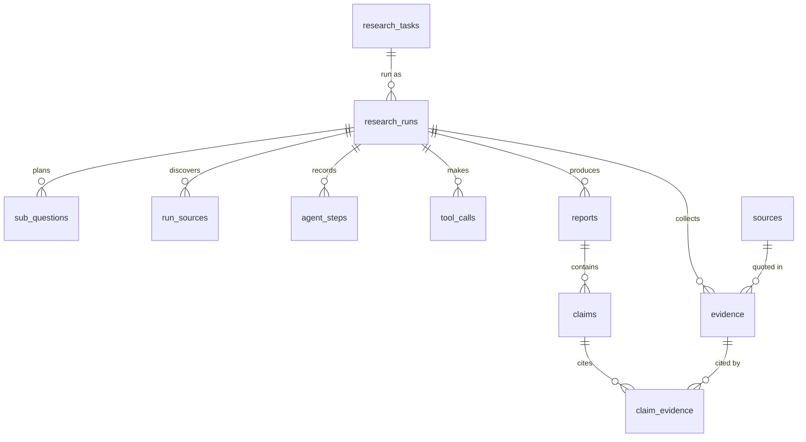
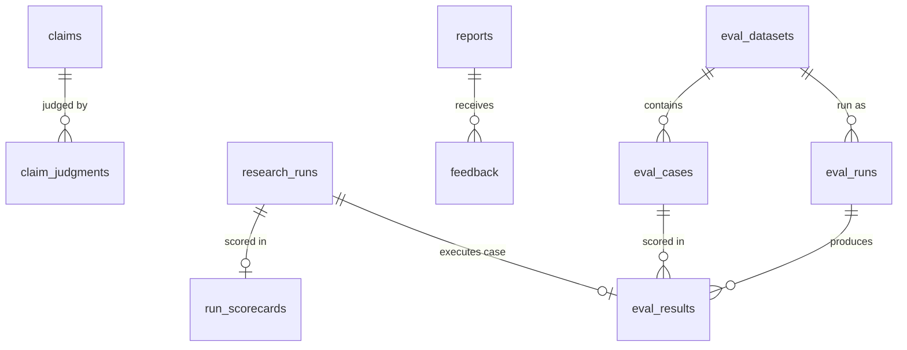

# VerityAI Backend — Architecture

> **VerityAI — Evaluated Research Agent** · *Research with evidence. Answers with confidence.*

How the backend works: the processes, what happens when a request comes in, how a research run
flows through the system, the database design, and where to change things. Everything here
describes the code in this repository; file paths are relative to the repo root.

A viewable version of this document is generated with `npm run docs:build` →
`docs/architecture.html` (open it in a browser).

---

## 1. Overview

The backend is a **modular monolith** in TypeScript with **two processes** built from the same code:

| Process | Entry point | Job |
|---|---|---|
| **API** | `src/server.ts` → `src/app.ts` | HTTP API under `/api/v1`: auth, research tasks, sources, reports, evaluations, policies. Streams live run progress (SSE). Never does slow AI work itself. |
| **Worker** | `src/worker.ts` | Background jobs: research runs (the agent), document ingestion, offline eval runs, maintenance sweeps. |
| **Both** (optional) | `src/all.ts` | Runs the API and the worker as two child processes in one container (`PROCESS=all`), for hosts where they can't share a disk. |

They talk only through **Postgres**: rows, a job queue (pg-boss) and `LISTEN/NOTIFY` events. No
Redis, no message broker.

### Tech stack

| Concern | Choice |
|---|---|
| Runtime | Node.js 22, TypeScript (strict, ESM) |
| HTTP | Express 5, helmet, cors, express-rate-limit, multer (uploads), cookie-parser |
| Validation | zod 4 (request schemas, env, LLM structured outputs) |
| Database | PostgreSQL 16 + pgvector, Drizzle ORM + drizzle-kit migrations |
| Jobs | pg-boss (queue tables inside Postgres) |
| Live updates | Postgres `LISTEN/NOTIFY` → Server-Sent Events |
| LLM | OpenAI Responses API (`gpt-5-mini` by default) behind `src/infrastructure/llm`; a `fake` provider for tests |
| Search | Tavily (web), arXiv, Semantic Scholar |
| Parsing | unpdf (PDF), Readability + linkedom (HTML) |
| Code sandbox | QuickJS (WebAssembly) |
| Export | marked + pdfkit (PDF), DejaVu fonts |
| Logging / tracing | pino; an OpenTelemetry-shaped tracer that stores spans in Postgres |
| Tests | Vitest + Supertest against a real Postgres |

---

## 2. Architecture



- The **API** validates, authorizes, stores and enqueues. It answers in milliseconds.
- The **worker** does everything slow or expensive: LLM calls, searching, fetching, parsing,
  embedding, evaluating.
- **Postgres** is the single source of truth. Events (`NOTIFY`) only make the UI live; if one is
  missed, the next snapshot from the database is still correct.
- Uploaded files live on disk (`STORAGE_DIR`), shared by both processes.

---

## 3. Folder structure

```text
src/
├── server.ts / worker.ts / all.ts   process entry points
├── app.ts                           Express app: middleware order and route mounting
├── config/env.ts                    every environment variable, validated with zod at startup
├── infrastructure/                  technical adapters (no business rules)
│   ├── database/                    Drizzle client, schema/*.ts (tables), migrations/*.sql
│   ├── events/run-events.ts         LISTEN/NOTIFY event bus (+ in-memory version for tests)
│   ├── http/safe-fetch.ts           SSRF-safe downloader
│   ├── llm/                         OpenAI client, fake client, pricing, structured output
│   ├── queue/queue.ts               pg-boss setup and queue names
│   └── storage/file-storage.ts      local-disk file storage
├── middleware/                      request id, logging, auth, permissions, validation, rate limits, errors
├── modules/                         one folder per feature (see below)
├── scripts/                         CLIs: db-setup.ts, eval.ts, build-docs.ts
├── shared/                          errors, logger, request metadata, db error helpers
└── tests/                           test helpers and shared setup
```

| Module | Responsibility |
|---|---|
| `auth` | register, login, refresh-token rotation, logout, `/me` |
| `organizations` | organization and members (roles) |
| `research` | research tasks and runs: create, list, detail, cancel, SSE stream, trace, scorecard |
| `agent` | the agent runtime (stage machine), stages, prompts, run state, budgets, fakes |
| `tools` | search providers, discovery, the code sandbox |
| `retrieval` | parsing, chunking, ingestion, hybrid search, source acquisition |
| `sources` | collections, uploads, documents, chunk viewer, search endpoint |
| `policies` | permissions (RBAC), the policy gateway, tool executor, approvals |
| `observability` | tracer, traced LLM wrapper, trace summary, metrics, partitions |
| `evaluation` | online scorers and judges, scorecards, feedback, offline datasets / eval runs / comparison |
| `reports` | report list, versions, Markdown/PDF export with bibliography |
| `audit` | audit log writes |
| `health` | `/api/v1/health` |

**Module convention:** `*.routes.ts` (paths, middleware) → `*.controller.ts` (HTTP in/out) →
`*.service.ts` (business rules) → `*.repository.ts` (SQL via Drizzle). Smaller modules keep the
handler inside the routes file. Every repository function takes `organizationId`.

---

## 4. When a request comes in

### 4.1 The middleware chain (`src/app.ts`)



- **Order matters:** the request id comes first so every log line and error response carries it.
- Public routes (`/health`, `/auth/*`) skip `authenticate`.
- `authenticate` verifies the access token and **reloads the membership from the database**, so a
  removed member or a changed role takes effect immediately.
- `requirePermission` maps the role to allowed actions (`src/modules/policies/permissions.ts`).
- Uploads add `multer` (in memory, ≤ `MAX_UPLOAD_MB`) after validation.

### 4.2 Errors

All errors end in `src/middleware/error-handler.ts` and leave as one JSON shape:

```json
{ "error": { "code": "NOT_FOUND", "message": "Run not found", "details": null, "requestId": "…" } }
```

| Thrown | Status | Code |
|---|---|---|
| `ValidationError`, zod errors | 400 | `VALIDATION_ERROR` |
| `UnauthorizedError` | 401 | `UNAUTHORIZED` |
| `ForbiddenError` | 403 | `FORBIDDEN` |
| `NotFoundError` (also for other organizations' ids) | 404 | `NOT_FOUND` |
| `ConflictError` | 409 | `CONFLICT` |
| upload too large (multer) | 413 | `FILE_TOO_LARGE` |
| `TooManyRequestsError` | 429 | `RATE_LIMITED` |
| invalid JSON body | 400 | `INVALID_JSON` |
| anything else | 500 | `INTERNAL_ERROR` (details logged, never sent) |

### 4.3 Example: `GET /api/v1/research/runs/:runId`



### 4.4 Authentication flow (`src/modules/auth`)



Login and register: 10 attempts per 15 minutes per IP; refresh and logout: 60 per 15 minutes.

---

## 5. A research run, end to end

Starting research is fast; the work happens in the worker; progress streams back over SSE.



### 5.1 Stages (`src/modules/agent/stages/`)

| # | Stage | File | What it does | Writes |
|---|---|---|---|---|
| 1 | planning | `plan.ts` | LLM breaks the question into 2–4 sub-questions + search queries (`plan-v1`) | `sub_questions` |
| 2 | discovering* | `discover.ts` | web + academic search per sub-question, ranked | `run_sources` (candidate) |
| 3 | acquiring* | `acquire.ts` | safe fetch, parse, dedupe, index the best sources | `sources`, `source_chunks`, `run_sources` |
| 4 | retrieving | `retrieve.ts` | hybrid search over readable collections + the run's sources | run state (passages) |
| 5 | extracting | `extract.ts` | LLM quotes evidence; quotes must appear verbatim (`extract-v1`) | `evidence` |
| 6 | analyzing | `analyze.ts` | tool loop with sandboxed `run_code` (`analyze-v1`) | `tool_calls`, run state (notes) |
| 7 | synthesizing | `synthesize.ts` | streams the cited report (`report-v1`) | `reports`, `claims`, `claim_evidence` |
| 8 | evaluating | `evaluate.ts` | judges claims, scores, revises once if < 90 % supported | `claim_judgments`, `run_scorecards` |

\* only when the run has discovery on.

### 5.2 Run control

- **State and resume:** after every stage the runtime saves `research_runs.state` (completed
  stages, step count, usage, passages). The `research.run` queue has a 60 s heartbeat and one
  retry; if a worker dies, the retry resumes from the last completed stage.
- **Budgets** (`agent/budget.ts`): max steps (60), tokens (400k), cost ($1), time (10 min) by
  default; the org policy and the run config can change them. Out of budget either fails the run
  or asks for approval (policy `onExceed`).
- **Cancel:** `POST /research/runs/:id/cancel` sets the status and publishes an event; the worker
  aborts the in-flight LLM call.
- **Approval pause:** a tool call that needs approval stores an `approvals` row and the run goes
  to `awaiting_approval`; deciding re-queues it and it continues where it stopped.
- **Stalled runs:** a sweep marks runs with no checkpoint for 30 minutes as failed (`STALLED`).
- **SSE protocol** (`research/research.sse.ts`): `snapshot` (full run detail), `status`,
  `delta {offset, text, version}` (version 2 = the revision), `done`. The API subscribes before
  reading the first snapshot, so no event is lost in between.

---

## 6. Tool calls and the policy gateway

Stages never call tools directly: every call goes through `ctx.tools.call` →
`policies/executor.ts` → `policies/policy-gateway.ts`.



Platform-wide domain rules (`BLOCKED_DOMAINS`, `ALLOWED_DOMAINS`) apply on top of each
organization's policy (`policies` table, versioned).

---

## 7. Retrieval and ingestion



- **Safe fetch** (`infrastructure/http/safe-fetch.ts`): http(s) only, ports 80/443, DNS resolved
  and every address checked (no private, loopback, link-local or metadata ranges), connection
  pinned to the checked IP, every redirect re-checked (max 5), size and time limits.
- **Dedupe:** by content hash and canonical URL per organization; the same document is stored
  and embedded once and linked to several collections.
- **Access:** a run only searches the collections its creator could read when it started
  (decided by the API and stored in the run config).

---

## 8. Evaluation

### 8.1 Online (every run, stage `evaluating`)

1. **Claim judge** (`evaluation/prompts/claim-judge.ts`): each cited sentence vs. only the quotes
   it cites → supported / partial / unsupported, per-citation verdicts, rationale.
2. **Task judge**: how completely the report does what was asked.
3. **Deterministic scorers** (`evaluation/scorers/`): citation validity, coverage, source
   reliability, contradiction handling, policy compliance.
4. **Revision loop:** claim support < 90 % → rewrite once with the flagged claims (`revise-v1`),
   judge again, keep the better version (the other is `superseded`).
5. **Scorecard** → `run_scorecards`; readers can rate reports and claims (`feedback`).

### 8.2 Offline (benchmarks, `evaluation/offline/`)

- Datasets of cases (question, required points, expected/forbidden sources, forbidden content,
  category). `POST /evals/datasets/starter` installs a 25-case benchmark with fixture documents.
- `POST /evals/runs` freezes a config (model, prompt versions, policy version, top K, discovery,
  revision, collections) and enqueues `eval.run`. The runner executes each case through the
  same agent runtime, **unattended**, then scores it (`case-scorers.ts`). Red-team cases are gated
  on security checks only.
- Summaries and comparisons (`summary.ts`); the CLI `npm run eval` runs the same in-process for CI.

---

## 9. Database design

### 9.1 Conventions

- **Ids:** UUID v7 (time-ordered) generated in the app (`schema/columns.ts`).
- **Tenancy:** every tenant-owned table has `organization_id`; every query filters by it.
- **Timestamps:** `created_at` / `updated_at` as `timestamptz`.
- **Naming:** snake_case in SQL, camelCase in TypeScript (Drizzle `casing: "snake_case"`).
- **Deletes:** cascades from parent to children; soft delete (`deleted_at`) only on `sources`,
  `collections` and `research_tasks`.
- **Schema source:** `src/infrastructure/database/schema/*.ts`; migrations generated with
  `npm run db:generate` into `migrations/`, applied with `npm run db:migrate` or `npm run db:setup`.

### 9.2 Identity and knowledge



| Table | Purpose | Key columns / indexes |
|---|---|---|
| `organizations` | tenants | `slug` unique, `settings` jsonb |
| `users` | accounts | `email` citext unique, `password_hash` (argon2id) |
| `organization_members` | user ↔ org with a role | `role` (owner, admin, researcher, viewer); unique (org, user) |
| `refresh_tokens` | rotating sessions | `token_hash` unique, `family_id`, `revoked_reason` |
| `collections` | groups of documents | `visibility` (private, organization) |
| `sources` | documents: uploads, web pages, papers | `type`, `status`, `content_hash` unique per org, `canonical_url` unique per org, `doi`, `authors`, `reliability_score` |
| `source_chunks` | ~800-token pieces | `embedding vector(1536)` **HNSW** (cosine), `tsv` generated **GIN**, `embedding_model`, pages |
| `collection_sources` | collection ↔ source | primary key (collection, source) |

### 9.3 Research



| Table | Purpose | Key columns |
|---|---|---|
| `research_tasks` | the question as asked | `question`, `instructions`, `origin` (user, eval) |
| `research_runs` | one execution of the agent | `status`, `stage`, `config` (collections, discovery, budget, eval), `model`, `prompt_version`, `state` (checkpoint), tokens, `cost_usd` |
| `sub_questions` | the plan | `position`, `search_queries[]`, `coverage` |
| `run_sources` | sources found by search and what happened to them | `status` (candidate, acquired, used, rejected, blocked), `reason`, `provider` |
| `evidence` | verbatim quotes, cited as `[rank]` | `quote`, `stance`, `confidence`, `chunk_id`, unique (run, rank) |
| `agent_steps` | every LLM call / tool call / observation | `seq`, `stage`, `type`, input/output jsonb, tokens, cost |
| `tool_calls` | tool calls with result | `tool`, `args`, `args_hash` (idempotency), `status`, `result` |
| `reports` | the answer, versioned | `version`, `status` (draft, final, superseded), `content_md` |
| `claims` | cited sentences | `position`, `section`, `text` |
| `claim_evidence` | the citation link | (claim, evidence), `citation_number` |

### 9.4 Governance

| Table | Purpose | Key columns |
|---|---|---|
| `policies` | versioned agent policy per org | `version`, `is_active` (one active per org), `rules` jsonb |
| `policy_decisions` | the gateway's verdict on every tool call | `decision`, `matched_rule`, `reason`, `checks` |
| `approvals` | human decisions the agent waits for | `kind` (tool_call, budget), `status`, `expires_at`, decided by/at |
| `audit_logs` | security-relevant actions | `action`, actor, resource, ip, user agent |

### 9.5 Evaluation



| Table | Purpose | Key columns |
|---|---|---|
| `claim_judgments` | judge verdict per claim | `verdict`, `citation_accurate`, `citations` (per-citation), `rationale`, judge model and prompt version |
| `run_scorecards` | online scorecard per run | the metrics, `policy_compliant`, `passed`, `extra` (counts, flags, sources, revision) |
| `feedback` | thumbs on reports / claims | `rating` ±1; unique (user, report, claim) nulls not distinct |
| `eval_datasets` | benchmarks | `name` unique per org, `collection_id` |
| `eval_cases` | questions with expectations | required points, expected / forbidden sources, forbidden content, `category` |
| `eval_runs` | one benchmark execution | frozen `config`, `status`, `summary` |
| `eval_results` | per-case outcome | `scores`, `passed`, `failures[]`, `details` (warnings, point verdicts) |

### 9.6 Observability

`trace_spans` holds every span (trace id = run id): name, parent, attributes (model, tokens,
cost, tool, decision), status, timings. It is **partitioned by month** on `start_time` (hand-edited
migration 0008); the worker creates upcoming months and drops months older than 30 days.

### 9.7 Enums

`member_role`, `token_revoke_reason`, `run_status`, `run_stage`, `step_type`, `report_status`,
`collection_visibility`, `source_type`, `source_status`, `run_source_status`, `coverage_status`,
`evidence_stance`, `tool_call_status`, `policy_decision`, `approval_status`, `approval_kind`,
`span_status`, `claim_verdict`, `eval_run_status`, `task_origin` (all in `schema/enums.ts`).

### 9.8 Migrations

| # | File | Adds |
|---|---|---|
| 0000 | `enable_extensions` | `vector`, `citext` |
| 0001 | `identity_tables` | organizations, users |
| 0002 | `auth_and_audit` | organization members, refresh tokens, audit logs |
| 0003 | `research_runs` | research tasks, runs, agent steps, reports |
| 0004 | `knowledge_base` | collections, sources, chunks (vector + generated tsvector), evidence, claims, claim ↔ evidence |
| 0005 | `run_sources` | discovered sources per run; `sources.fetched_at` |
| 0006 | `pipeline` | sub-questions, tool calls; evidence stance/confidence/note; run `state`; PDF links and metadata on run sources |
| 0007 | `governance` | policies, policy decisions, approvals; tool call `stage` and `args_hash` |
| 0008 | `trace_spans` | partitioned spans (hand-edited) |
| 0009 | `online_evaluation` | claim judgments, scorecards, feedback |
| 0010 | `offline_evaluation` | eval datasets, cases, runs, results; task origin |

Rule: never edit an applied migration; add a new one.

### 9.9 Database roles

`deploy/db-roles.sql` creates two roles: `verity_migrator` owns the schema (migrations, pg-boss
install, partitions) and `verity_app` can only read and write rows. In production the API and
worker connect as `verity_app` (`DATABASE_URL`); `npm run db:setup` and partition maintenance use
`MIGRATION_DATABASE_URL`.

---

## 10. Background jobs and maintenance

| Queue | Producer | Consumer | Concurrency | Retries | Notes |
|---|---|---|---|---|---|
| `research.run` | `POST /research/tasks`, re-run, approval decided | `agentRuntime.runResearch` | 4 | 1 (resumes) | heartbeat 60 s, expires after 15 min |
| `source.ingest` | uploads, re-ingestion | `ingestion.ingestSource` | 2 | 2 (backoff) | idempotent: replaces a source's chunks |
| `eval.run` | `POST /evals/runs` | `evalRunner.execute` | 1 | 1 (resumes) | heartbeat 60 s, expires after 6 h |

Periodic work in `src/worker.ts`:

| Every | Task |
|---|---|
| 5 min | expire stale approval requests; mark runs stalled for 30 min as failed |
| 6 h (and at start) | create the next trace partitions, drop expired ones |

---

## 11. Observability

- `modules/observability/tracer.ts`: `inSpan` starts a root span (`run`, one per attempt),
  `withSpan` nests under the current span via `AsyncLocalStorage`, so any code inside a run is
  traced without passing span objects around. Spans are buffered and written in batches.
- Span names: `run`, `stage.<stage>`, `llm.<method>` (model, tokens, cost, time to first token),
  `tool.<name>`, `policy.check`, `parse`, `ingest.index`, `llm.embed`.
- `GET /research/runs/:id/trace` returns the spans plus a summary (time and cost per stage,
  slowest operations); `GET /observability/metrics?days=7|30|90` aggregates latency
  percentiles, tool errors, denials, cost and failures.
- Logs: pino JSON (pretty in development), one line per request with the request id.

---

## 12. Security summary

| Area | Control | Where |
|---|---|---|
| Authentication | argon2id, 15-min JWT, rotating httpOnly refresh cookie with reuse detection | `modules/auth` |
| Authorization | RBAC on every route | `policies/permissions.ts`, `middleware/require-permission.ts` |
| Tenancy | `organization_id` filter in every repository; foreign ids → 404 | repositories |
| Agent actions | policy gateway on every tool call, approvals, budgets | `modules/policies` |
| SSRF | safe fetcher | `infrastructure/http/safe-fetch.ts` |
| Code execution | QuickJS sandbox, no network or filesystem, limits | `tools/code.tool.ts` |
| Prompt injection | documents wrapped as untrusted data, verbatim quote check, red-team evals | prompts, `stages/extract.ts` |
| HTTP | helmet, CORS allowlist, body limits, rate limits | `app.ts`, `middleware/rate-limit.ts` |
| Database | least-privilege roles | `deploy/db-roles.sql` |
| Secrets | env only, validated; production refuses fake provider / example secrets | `config/env.ts` |

The full review with red-team results is `docs/security-review.md` in the project documentation.

---

## 13. Configuration (`src/config/env.ts`)

| Group | Variables (default) |
|---|---|
| Server | `NODE_ENV` (development), `PORT` (4000), `LOG_LEVEL` (info), `CORS_ORIGINS` (empty) |
| Database | `DATABASE_URL` (required), `MIGRATION_DATABASE_URL` (optional, schema owner) |
| Auth | `JWT_SECRET` (required, ≥ 32 chars), `ACCESS_TOKEN_TTL_SECONDS` (900), `REFRESH_TOKEN_TTL_DAYS` (30) |
| Storage | `STORAGE_DIR` (storage), `MAX_UPLOAD_MB` (25) |
| Discovery | `WEB_SEARCH_PROVIDER` (none / tavily), `TAVILY_API_KEY`, `ACADEMIC_SEARCH` (arxiv), `SEMANTIC_SCHOLAR_API_KEY`, `BLOCKED_DOMAINS`, `ALLOWED_DOMAINS`, `FETCH_MAX_MB` (10), `FETCH_TIMEOUT_MS` (20000), `MAX_SOURCES_PER_RUN` (5) |
| LLM | `LLM_PROVIDER` (openai / fake), `OPENAI_API_KEY`, `OPENAI_MODEL` (gpt-5-mini), `OPENAI_EMBEDDING_MODEL` (text-embedding-3-small) |

The app refuses to start with an invalid configuration. With `NODE_ENV=production` it also
refuses the fake provider, a missing API key for an enabled provider and the example JWT secret.

---

## 14. Running it

| Command | What it does |
|---|---|
| `npm run db:up` | start Postgres + pgvector in Docker (port 5433) |
| `npm run db:migrate` | apply migrations |
| `npm run db:setup` | release step: migrations, job queue, trace partitions, grants |
| `npm run dev` | API with reload |
| `npm run worker` | worker with reload |
| `npm test` | Vitest (integration tests use the `verity_test` database) |
| `npm run lint` · `npm run typecheck` · `npm run build` | checks and build |
| `npm run eval -- --dataset ai-agents [--category red_team] [--limit N]` | offline eval from the terminal |
| `npm run docs:build` | regenerate `docs/architecture.html` from this file |

**Docker:** one image (`Dockerfile`) runs `PROCESS=api | worker | all | setup | setup-and-all`
(`deploy/entrypoint.sh`); `deploy/docker-compose.full.yml` starts Postgres, setup, API, worker
and the frontend. **CI:** `.github/workflows/ci.yml` runs lint, format, typecheck, tests, build,
`db:setup` and a red-team eval smoke test with the fake provider.

---

## 15. Where to change things

| I want to… | Touch |
|---|---|
| add an API endpoint | the module's `*.routes.ts` (path + `requirePermission` + `validate`), controller, service, repository; a test next to it |
| add a table or column | `src/infrastructure/database/schema/*.ts`, then `npm run db:generate`; add the table to `resetDatabase` in `src/tests/helpers.ts` |
| add a pipeline stage | `modules/agent/stages/<stage>.ts`, register it in `agent-runtime.ts` `stageFns` and `pipeline.ts`, add the stage to the `run_stage` enum |
| add an agent tool | the tool in `modules/tools`, its rules in `policies/policy-rules.ts`, call it through `ctx.tools.call` |
| change a prompt | `modules/agent/prompts/*.ts` or `modules/evaluation/prompts/*.ts`; bump the version constant and compare with an eval run |
| add a background job | queue name and options in `infrastructure/queue/queue.ts`, consumer in `worker.ts` |
| change limits | budgets in the org policy or `agent/budget.ts`; rate limits in `middleware/rate-limit.ts` |
